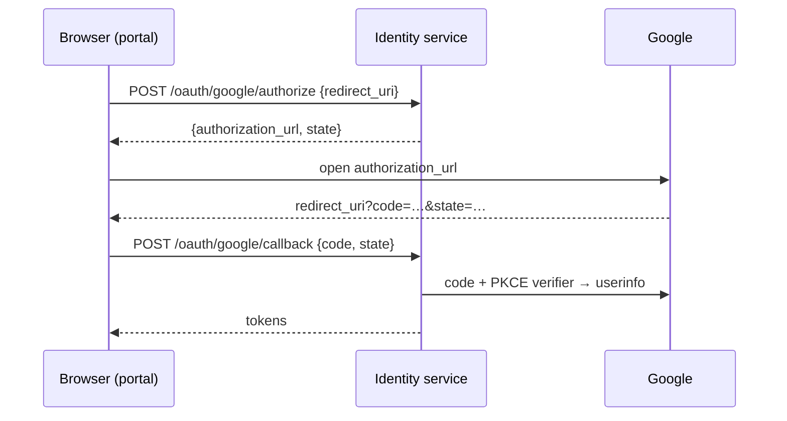

# API

Everything is JSON. `/docs` on a running service is the interactive version of
this page, and `/openapi.json` the machine-readable schema.

Routes marked 🔒 need an access token: `Authorization: Bearer <access_token>`.

## Tokens

Every successful sign-in (`/auth/login`, `/oauth/{provider}/callback`) and every
refresh answers with:

```json
{
  "access_token": "eyJhbGciOiJSUzI1NiIsImtpZCI6Ii4uLiJ9...",
  "refresh_token": "Xq3...Yw.AbC...",
  "token_type": "Bearer",
  "expires_in": 900
}
```

- `access_token`: send it to the other services. It expires after
  `expires_in` seconds (15 minutes).
- `refresh_token`: keep it, and exchange it at `/auth/refresh` for a new pair.
  **It works once.** Always keep the new one; using an old one again ends the
  session.

## Accounts

### `POST /auth/register`

```json
{"email": "jimbo@example.com", "password": "at least 8 characters", "display_name": "Jimbo"}
```

**201** `{"user_id": "…", "email_verification_required": true}`. A 6-digit code
is emailed. The account can't sign in until `/auth/confirm-email`.

- The email is trimmed and lower-cased: `Jimbo@Example.com` is the same account.
- The password needs 8 characters to 72 bytes (bcrypt's limit).
- The display name is 3 to 24 letters, digits, spaces, `.`, `_` or `-`, with
  spaces trimmed and collapsed. It isn't unique: players are told apart by id.

| Error | |
|---|---|
| 403 `email_not_verified` | the address is registered but not confirmed: ask for a new code (`/auth/resend-confirmation`) |
| 409 `user_exists` | the address has an account |
| 422 `invalid_password`, `invalid_display_name`, `invalid_email`, `invalid_request` | |

### `POST /auth/confirm-email`

`{"email": "...", "code": "123456"}` → **204**. The code is valid for 10 minutes
and 5 guesses.

| Error | |
|---|---|
| 400 `invalid_code` | wrong, expired, used, or guessed too many times |

### `POST /auth/resend-confirmation`

`{"email": "..."}` → **202**, whether the account exists or not.

| Error | |
|---|---|
| 429 `too_many_attempts` | a code was sent less than a minute ago (`Retry-After` header and `retry_after` field, in seconds) |

### `POST /auth/login`

`{"email": "...", "password": "..."}` → **200** tokens.

| Error | |
|---|---|
| 401 `invalid_credentials` | the same for an unknown email and a wrong password |
| 403 `email_not_verified` | right password, unconfirmed email |
| 429 `too_many_attempts` | 10 wrong passwords for this account in 15 minutes; `retry_after` |

### `POST /auth/refresh`

`{"refresh_token": "..."}` → **200** tokens (a new refresh token too).

| Error | |
|---|---|
| 401 `invalid_token` | unknown, expired, ended, or used before (which also ends the session) |

### `POST /auth/logout`

`{"refresh_token": "..."}` → **204**. Ends that session. Its access token keeps
working until it expires, for at most 15 minutes.

### `POST /auth/logout-all` 🔒

→ **204**. Ends every session of the account.

### `GET /auth/me` 🔒

```json
{
  "id": "5a68c181-8295-48a4-be76-90596b92e45b",
  "email": "jimbo@example.com",
  "display_name": "Jimbo",
  "email_verified": true,
  "has_password": true,
  "providers": ["google"],
  "created_at": "2026-10-24T20:04:21.647539Z",
  "roles": ["developer"]
}
```

### `PATCH /auth/me` 🔒

`{"display_name": "Lucky Cat"}` → **200**, the account. Access tokens already
issued keep the old name (`name` claim) until they are refreshed.

### `DELETE /auth/me` 🔒

→ **204**. Deletes the account, its password and its linked providers, and ends
its sessions. Other services keep their data about the account; nothing tells
them yet.

### `POST /auth/password/forgot`

`{"email": "..."}` → **202**, whether the account exists or not. An existing
account gets a reset code. The same limits as confirmation codes apply (429).

### `POST /auth/password/reset`

`{"email": "...", "code": "123456", "password": "new password"}` → **204**.

- Sets the password, and creates one for an account that only signed in with
  Google.
- Confirms the email, since the code proves the user reads that inbox.
- Ends every session.

| Error | |
|---|---|
| 400 `invalid_code` | |
| 422 `invalid_password` | |

## Sign in with a provider

The flow (an OAuth 2 authorization code flow with PKCE):



### `GET /oauth/providers`

`{"providers": ["google"]}`: the providers configured on this server, or an
empty list.

### `POST /oauth/{provider}/authorize`

`{"redirect_uri": "https://example.com/auth/callback"}` →
`{"authorization_url": "https://accounts.google.com/...", "state": "..."}`.
Open `authorization_url` in the browser. The state is valid for 10 minutes.

| Error | |
|---|---|
| 400 `redirect_uri_not_allowed` | not one of the server's `OAUTH_REDIRECT_URIS` |
| 404 `oauth_provider_disabled` | the provider isn't configured |

### `POST /oauth/{provider}/callback`

`{"code": "...", "state": "..."}`, taken from the query of the page Google
redirected to → **200** tokens.

- A provider account seen before signs in its user.
- A new one is linked to the account with the same email. Google must say the
  email is verified. If that account was never confirmed, its password is
  removed: whoever registered it hadn't proved they own the address.
- With no account for the email, a new one is created. Its display name is
  the Google profile's name, keeping only the allowed characters and at most
  24 of them, or a random one (`Player1234`) when too little is left. Google
  is asked for the `openid email profile` scopes.
- When the flow started at `/oauth/{provider}/link`, the provider's account is
  linked to that signed-in account instead, whatever its email.

| Error | |
|---|---|
| 400 `invalid_oauth_state` | unknown, expired or used state, or another provider's |
| 400 `oauth_exchange_failed` | Google refused the code (expired, used, or a wrong `redirect_uri`) |
| 403 `oauth_email_not_verified` | |
| 409 `oauth_account_conflict` | the account is already linked to another Google account |
| 409 `oauth_account_in_use` | (linking) this Google account belongs to another player |

### `POST /oauth/{provider}/link` 🔒

`{"redirect_uri": "..."}` → as `/authorize`, for a signed-in player who wants
to sign in with that provider too, whatever the provider account's email.
The callback (`POST /oauth/{provider}/callback`, as above) links it and
answers with tokens for this account: keep them, they start a new session.

| Error | |
|---|---|
| 401 `invalid_token` | not signed in |
| 400 `redirect_uri_not_allowed`, 404 `oauth_provider_disabled` | as `/authorize` |

### `DELETE /oauth/{provider}` 🔒

→ **204**. Unlinks the provider.

| Error | |
|---|---|
| 404 `oauth_account_not_found` | not linked |
| 409 `last_sign_in_method` | no password and no other provider: set a password first (`/auth/password/forgot`) |

## Roles

Roles say what an account may do beyond playing; access tokens name them
(`roles`, see [integration.md](integration.md#roles)). The first admin is
named from the command line (`python -m app.manage grant <email> admin`);
admins then give roles here. The last admin can't lose the role.

### `GET /roles`

```json
[{"role": "admin", "description": "manages accounts' roles; everything a developer may do"},
 {"role": "developer", "description": "reads the bug reports and rebuilds runs from them"},
 {"role": "tester", "description": "uses the game's test helpers (money, jokers, bosses) in their runs"}]
```

### `GET /admin/accounts?query=&role=&limit=50&offset=0` 🔒 admin

Accounts whose email or display name contains `query` (any case), with
`role` if given, oldest first:
`{"accounts": [{id, email, display_name, email_verified, roles, created_at}], "total": 1}`.
403 `forbidden` without the admin role (checked in the database, not in the
token).

### `PUT /admin/accounts/{id}/roles` 🔒 admin

`{"roles": ["developer", "tester"]}`: the account's roles become these. Answers
the account as in the list. 404 `user_not_found`, 409 `last_admin` when it would
leave no admin, 422 for an unknown role. The change is logged, and the record
keeps who gave each role and when.

## Service

### `GET /health`

`{"status": "ok", "database": "ok", "redis": "ok"}` (**200**), or **503** with
`"status": "degraded"` and the part that is `"down"`.

### `GET /.well-known/jwks.json`

The public keys that verify the access tokens (`Cache-Control: max-age=300`).
See [integration.md](integration.md).

## Errors

Every error is a problem details object
([RFC 9457](https://www.rfc-editor.org/rfc/rfc9457)), `application/problem+json`:

```json
{"type": "https://balatro-identity/errors/invalid_credentials", "title": "Unauthorized",
 "status": 401, "detail": "invalid email or password", "code": "invalid_credentials"}
```

Switch on `code`, which is stable. `detail` is English text for people.
`invalid_request` (422) adds `errors: [{loc, msg, type}]`, and
`too_many_attempts` (429) adds `retry_after`. A 401 has a `WWW-Authenticate`
header. 403 `forbidden` means the admin role is needed, and 409 `last_admin`
that the last admin can't lose it. 500 `internal_error` is a bug, and 503 `email_delivery_failed` means
the email couldn't be sent.
